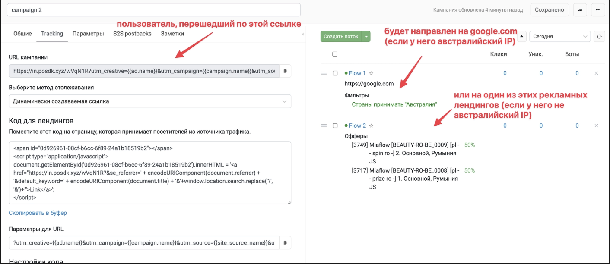
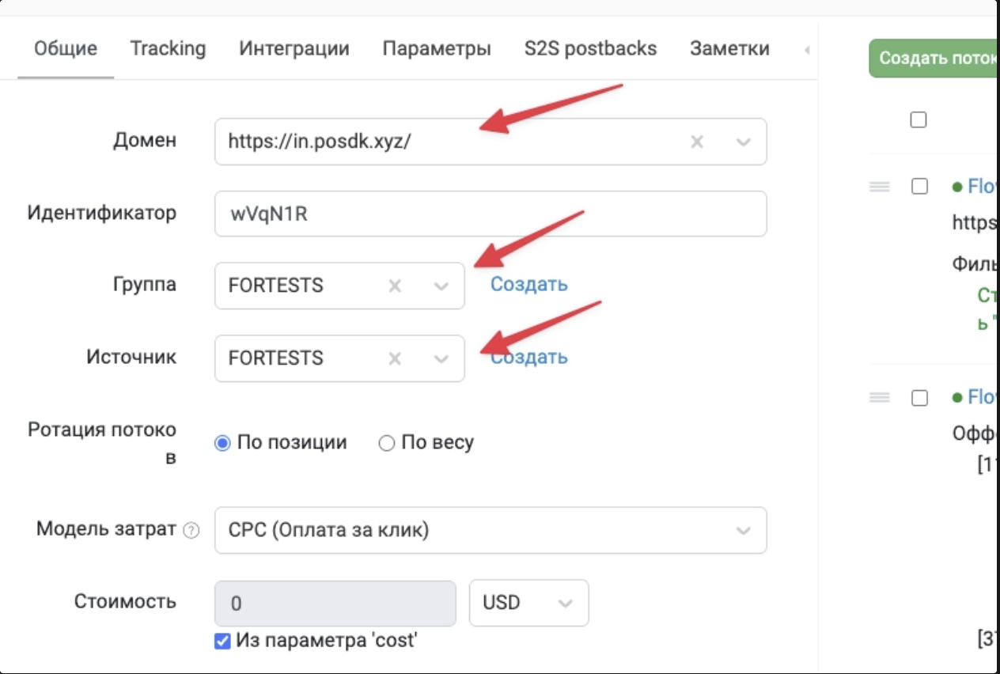
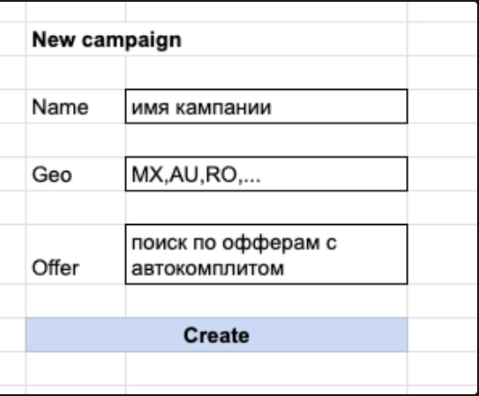

# Adrobot ТЗ

Это тестовое задание покажет вам пример одной из систем, с которой мы работаем.

Эта система - рекламный трекер Keitaro, с его помощью мы отслеживаем прибыльность наших рекламных объявлений. С технической точки зрения - это конструктор ссылок, который редиректит пришедших пользователей согласно настроенным правилам, а потом показывает статистику редиректов, например:

Ваша задача состоит из 2 частей:

# 1. Написать “создаватор” кампаний.

Он должен принимать название кампании, гео-код страны и ID оффера Keitaro и создавать кампанию, которая:

- имеет 2 потока: первый поток ловит всех из указанной страны и редиректит на гугл, второй поток редиректит на выбранный оффер
- имеет настроенные домен, группу и источник (все это тоже есть в API).
    
    
    

Вот примерный интерфейс:

# 2. Написать редактор существующей кампании.

Редактор должен уметь добавлять/удалять офферы в кампании. Этот редактор у нас уже есть, ниже - видео, как это выглядит и как работает. Вам нужно воспроизвести эту логику. Интерфейс - делайте на ваш вкус, главное, чтобы кнопки работали и цифры были верные.

https://youtu.be/jNloscEWCjA

# docs 
in .env there is
KEITARO_DOCS_URL
KEITARO_DOCS_LOGIN
KEITARO_DOCS_PASSWORD
which you can access and enter docs page

# Как сдавать тестовое

Проект должен быть написан на FastApi + SQLAlchemy. Фронт - можно сделать любой, хоть React, хоть HTML-ки с кусками jquery. 

Сдавать работу в виде ссылки на гитхабе с понятным README для миграций и запуска. Использование агентов типа Cursor/Windsurf категорически приветствуется.